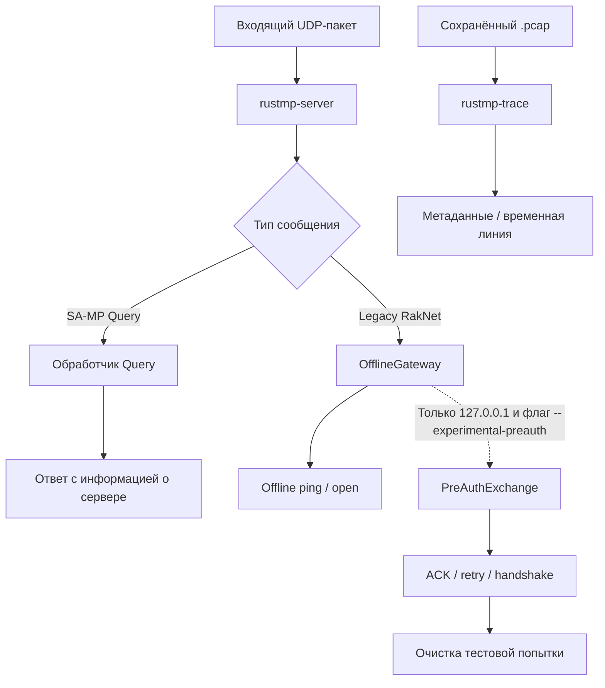

# Архитектура RUSTMP

RUSTMP — экспериментальный серверный стек на **Rust 2021**. Исходники разделены на четыре крейта Cargo workspace, чтобы разработка сетевого протокола, транспорта, игрового мира и исполняемого сервера оставалась независимой.

> [!IMPORTANT]
> Реализация пока **не поддерживает вход настоящих игроков**. Достижение конца pre-auth обмена не означает успешную авторизацию, а внутренние структуры `World` — не живые игровые сущности.

## Как устроен проект

| Крейт | Назначение | Сейчас |
| :--- | :--- | :--- |
| [`rustmp-core`](crates/rustmp-core/) | Модель мира, пулы ID, тестовые сущности | Базовая логика |
| [`rustmp-protocol`](crates/rustmp-protocol/) | UDP Query, BitStream, legacy frame/ACK, анализ PCAP | Кодеки и диагностические инструменты |
| [`rustmp-transport`](crates/rustmp-transport/) | Offline RakNet, cookie, retry, фрагментация, handshake | Частичная библиотечная реализация |
| [`rustmp-server`](crates/rustmp-server/) | UDP-сокет, конфигурация, маршрутизация, ограничения | Query + offline; тестовый pre-auth на localhost |

## Путь UDP-пакета

**Что здесь важно:** `rustmp-trace` работает исключительно с сохранёнными файлами, а `PreAuthExchange` используется в локальном экспериментальном режиме. Эти компоненты **не создают** авторизованного игрока.

## Границы реализации

### Уже проверяется автоматическими тестами

- SA-MP Query и отдельные offline-пакеты двух протокольных профилей.
- Кодирование и разбор ACK, надёжных кадров и split-заголовков.
- Транзакционное обновление состояния `VerifiedSessions::ingest`: при ошибке в одном из кадров состояние peer остаётся прежним. Сейчас это достигается копированием ограниченного состояния и требует профилирования перед production.
- Ограничения памяти, таймауты, дублирование и повторная доставка отдельных сообщений.
- Локальные UDP-тесты с запуском настоящего `rustmp-server`.
- Разбор **синтетических** classic PCAP и сопоставление offline-событий.

### Пока не реализовано

- Подтверждённая совместимость с настоящим SA-MP/open.mp клиентом.
- Полноценная игровая авторизация и безопасный публичный handshake.
- Реальная синхронизация игроков, транспорта и мира.
- Игровые RPC, Pawn/AMX, совместимость с готовыми модами.
- Нагрузочное и fuzz-тестирование для публичной эксплуатации.

### Диагностика надёжной доставки (alpha.18)

`rustmp-trace --reliable --port 7777` отслеживает последовательности надёжных RakNet-кадров и диапазоны ACK по каждой паре клиент/сервер. Метаданные собираются без полезных нагрузок, а ожидание ACK означает только отсутствие подтверждения **в конкретном PCAP**, не доказанную потерю UDP. Анализ ограничен 1024 потоками и 512 ожидающими подтверждения сообщениями на направление.

## Полезные ссылки

- [План разработки](PORTING_PLAN.md) — приоритеты и критерии готовности
- [Анализ сетевых дампов](TRACE_ANALYSIS.md) — использование `rustmp-trace`
- [Вклад в проект](CONTRIBUTING.md) — требования к изменениям
- [Политика безопасности](SECURITY.md) — границы прототипа

Вопросы о сторонних лицензиях и независимости проекта освещены в [README.md](README.md).
