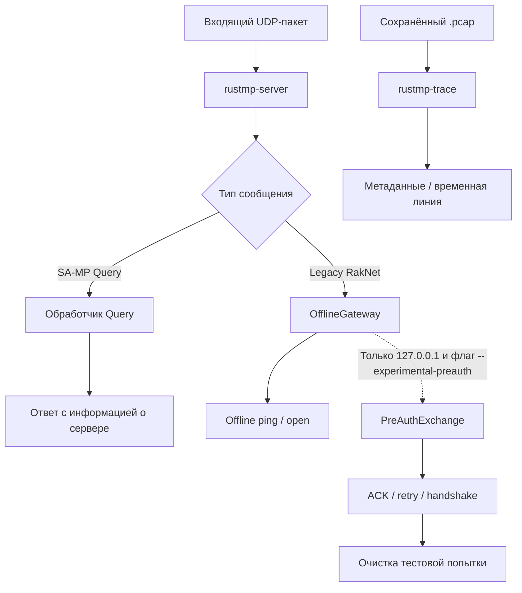

# Архитектура RUSTMP

RUSTMP — экспериментальный серверный стек на **Rust 2021**. Исходники разделены на четыре крейта Cargo workspace, чтобы разработка сетевого протокола, транспорта, игрового мира и исполняемого сервера оставалась независимой.

> [!IMPORTANT]
> Реализация пока **не поддерживает вход настоящих игроков**. Достижение конца pre-auth обмена не означает успешную авторизацию, а внутренние структуры `World` — не живые игровые сущности.

## Как устроен проект

| Крейт | Назначение | Сейчас |
| :--- | :--- | :--- |
| [`rustmp-core`](crates/rustmp-core/) | Модель мира, пулы ID, тестовые сущности | Базовая логика |
| [`rustmp-protocol`](crates/rustmp-protocol/) | UDP Query, BitStream, legacy frame/ACK, анализ PCAP | Кодеки и диагностические инструменты |
| [`rustmp-transport`](crates/rustmp-transport/) | Offline RakNet, cookie, retry, фрагментация, handshake | Частичная библиотечная реализация |
| [`rustmp-server`](crates/rustmp-server/) | UDP-сокет, конфигурация, маршрутизация, ограничения | Query + offline; тестовый pre-auth на localhost |

## Путь UDP-пакета

**Что здесь важно:** `rustmp-trace` работает исключительно с сохранёнными файлами, а `PreAuthExchange` используется в локальном экспериментальном режиме. Эти компоненты **не создают** авторизованного игрока.

## Границы реализации

### Уже проверяется автоматическими тестами

- SA-MP Query и отдельные offline-пакеты двух протокольных профилей.
- Кодирование и разбор ACK, надёжных кадров и split-заголовков.
- Транзакционное обновление состояния `VerifiedSessions::ingest`: при ошибке в одном из кадров состояние peer остаётся прежним. Сейчас это достигается копированием ограниченного состояния и требует профилирования перед production.
- Ограничения памяти, таймауты, дублирование и повторная доставка отдельных сообщений.
- Локальные UDP-тесты с запуском настоящего `rustmp-server`.
- Разбор **синтетических** classic PCAP и сопоставление offline-событий.

### Пока не реализовано

- Подтверждённая совместимость с настоящим SA-MP/open.mp клиентом.
- Полноценная игровая авторизация и безопасный публичный handshake.
- Реальная синхронизация игроков, транспорта и мира.
- Игровые RPC, Pawn/AMX, совместимость с готовыми модами.
- Нагрузочное и fuzz-тестирование для публичной эксплуатации.

### Диагностика надёжной доставки (alpha.18)

`rustmp-trace --reliable --port 7777` отслеживает последовательности надёжных RakNet-кадров и диапазоны ACK по каждой паре клиент/сервер. Метаданные собираются без полезных нагрузок, а ожидание ACK означает только отсутствие подтверждения **в конкретном PCAP**, не доказанную потерю UDP. Анализ ограничен 1024 потоками и 512 ожидающими подтверждения сообщениями на направление.

Диагностика в alpha.19 хранит ограниченную историю подтверждённых sequence ID (до 512 на направление). Повторное появление уже подтверждённого номера отмечается отдельно и не увеличивает количество ожидающих ACK. История не содержит полезных нагрузок и не служит для аутентификации клиентов.

### Надёжность pre-auth в alpha.20

При разборе локальной reliable-датаграммы `PreAuthExchange` сначала изменяет временную копию ограниченного состояния peer и handshake. ACK, номер сообщения и переходы auth применяются одновременно **только после полного успеха**. Исключение — осознанное завершение неверной авторизации, при котором попытка удаляется. Это корректность вместо максимальной производительности; до публичного использования требуется оптимизация затрат на копирование и проверка реальных клиентов.

Планировщик повторных отправок обходит ожидающие попытки циклически при ограничении в 64 датаграммы за вызов, исключая постоянное голодание поздних адресов.

### Финальное подтверждение pre-auth (alpha.21)

После завершения локального тестового обмена основной pre-auth и offline slot освобождаются. Небольшой отдельный кэш (максимум 128 записей, 3 секунды) допускает повтор **только ACK** для идентичного финального надёжного кадра с того же адреса и порта. При новом offline open кэш данной пары очищается; авторизованная игровая сессия не появляется.

### Устойчивость библиотечного транспорта (alpha.22)

`SplitAssembler` проверяет доступность лимита памяти **до** выделения новой группы. Границы остаются прежними: до 16 неполных split-групп, до 64 КиБ на группу и 128 КиБ всего; идентичные дубликаты не увеличивают буфер. `OutboundReliability::expedite_oldest` выбирает самое старое **пригодное к повторной отправке** сообщение, а не блокируется на старом пакете с исчерпанным retry.

Обе подсистемы тестируются библиотечно и **не доказывают совместимость с настоящим GTA-клиентом**.

### Повторная доставка проверенных сессий (alpha.23)

`VerifiedSessions::poll_retries` — отдельный библиотечный планировщик. Он возвращает адресованные datagram-пакеты и список сессий, которые нужно отключить после исчерпания лимита попыток. Ограничения: **64 датаграммы на вызов, максимум 4 на одну сессию**, детерминированный порядок и циклический обход адресов. Обновление очередей выполняется только после успешного кодирования всех выбранных пакетов.

`OutboundReliability::poll_retries` сначала выбирает давно не отправлявшиеся сообщения, чтобы при маленьком лимите новые номера sequence не голодали за старыми. Текущий рабочий UDP listener **не использует** `VerifiedSessions` и не принимает клиентов GTA; подключение требует отдельной, подтверждённой реальным трафиком реализации handshake/auth.

### Подготовка исходящего reliable-сообщения (alpha.24)

Библиотечный `VerifiedSessions::queue_reliable` принимает уже **проверенный** endpoint и payload, выполняет валидацию, резервирует sequence ID во временной копии `OutboundReliability` и кодирует datagram. Только при успешной сериализации изменённая очередь фиксируется. Возвращаются точный адрес и байты для внешнего `send_to`; отдельный `VerifiedSessions::poll_retries` повторно кодирует сообщения тем же кодировщиком, сохраняя первоначальные номера. Ошибка внешней отправки не означает подтверждение и не удаляет пакет из очереди.

Сборка очереди ACK теперь также транзакционная: удаление номеров происходит только после успешного кодирования. Этот компонент **по-прежнему не подключён к действующему UDP listener**, который не принимает реальных GTA-клиентов.

### Подготовка и подтверждение ACK после UDP-отправки (alpha.25)

`VerifiedSessions::prepare_ack_batch(peer)` делает снимок первых 64 ожидающих ACK и кодирует их **без изменения очереди**. Полученные неизменяемые `bytes()` и `peer()` можно передать в `UdpSocket::send_to`; только после успешной передачи вызывается `confirm_acks_sent(batch)`, удаляющий ровно номера из этой подготовленной партии. Неудачная отправка не требует отката: пакет отбрасывается, ACK остаются в ожидании.

Каждый допущенный endpoint имеет уникальное для реестра поколение сессии, поэтому подтверждение устаревшей партии после `disconnect`/повторного `admit_verified` возвращает `SessionError::StaleAckBatch` и **не затрагивает** новую очередь. Старый `take_ack_prefix` сохранён для совместимости, но его не следует использовать для ненадёжного внешнего `send_to`.

Это библиотечный этап подготовки к интеграции, **без** автоматического допуска клиентов и изменения режима публичного сервера.

## Полезные ссылки

- [План разработки](PORTING_PLAN.md) — приоритеты и критерии готовности
- [Анализ сетевых дампов](TRACE_ANALYSIS.md) — использование `rustmp-trace`
- [Вклад в проект](CONTRIBUTING.md) — требования к изменениям
- [Политика безопасности](SECURITY.md) — границы прототипа

Вопросы о сторонних лицензиях и независимости проекта освещены в [README.md](README.md).
